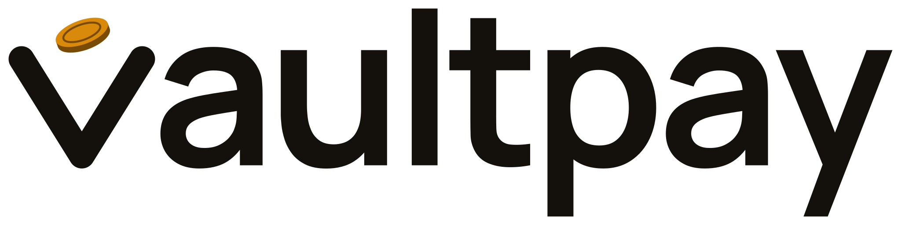

<picture>
  <source media="(prefers-color-scheme: dark)" srcset="logo/vaultpay-wordmark-on-dark.svg">
  
</picture>

# VaultPay Design System

Design system único dos 3 produtos da VaultPay: **Assist**, **Insights** e **Triage**.

> ⚠️ **A VaultPay é uma empresa fictícia.** Marca, nome e produtos são inventados, para estudo e portfólio.

> 🚧 **Em andamento.** Hoje existe a fundação (tokens, marca e vitrine). Veja o [Roadmap](#roadmap).

## Por quê

Três produtos com cara de uma empresa só precisam de **uma** fonte de cores, fontes e peças. Aqui é o "manual da marca em forma de código": cada produto aponta para uma versão marcada deste repositório, e todos usam exatamente a mesma coisa.

## Marca

Cor característica **Ouro** (`#F5A623`) sobre grafite quente.

**O símbolo:** o "v" é um cofre aberto e uma moeda de ouro cai dentro dele (guardar com segurança). Na palavra, esse mesmo símbolo é o primeiro "v" de "vaultpay", então símbolo e nome são o mesmo desenho.

| Arquivo | Uso |
|---|---|
| `logo/vaultpay-wordmark-on-light.svg` / `-on-dark.svg` | Palavra completa, para fundo claro / escuro. A palavra é contorno (não depende de fonte). |
| `logo/vaultpay-mark-on-light.svg` / `-on-dark.svg` | Só o símbolo, cores fixas, para ``. |
| `logo/vaultpay-mark.svg` | Símbolo para colocar **direto na página** (SVG inline): o v segue a cor do texto e a moeda segue os tokens `--vp-brand-coin`. Em `` o v fica preto. |
| `logo/vaultpay-mark-mono.svg` | Uma cor só (`currentColor`), também para uso inline. |
| `logo/vaultpay-app-icon.svg` | Ícone de app (fundo grafite). |
| `logo/favicon.svg` | Favicon e tamanhos de 20 px ou menos: a moeda vira um ponto, porque detalhe de 1 px vira borrão. |

Todos os logos são **gerados** por `scripts/build_logo.py` a partir de uma geometria única; não edite os SVGs à mão.

## Como usar

Em um produto (a partir da primeira versão marcada):

```bash
npm install github:Nathaly-Dev/vaultpay-design-system#v0.1.0
```

```css
@import "@vaultpay/design-system/fonts.css";
@import "@vaultpay/design-system/tokens.css";
```

As fontes (Manrope e IBM Plex Mono, licença OFL) vêm junto e são auto-hospedadas: nada é carregado de CDN. Origem e licenças em [`fonts/README.md`](fonts/README.md).

O tema segue o sistema (`prefers-color-scheme`). Para forçar: `<html data-theme="light">` ou `<html data-theme="dark">`.

## Vitrine

Para ver a marca, as cores e a tipografia nos dois temas, sirva a pasta e abra `showcase/index.html`:

```bash
python -m http.server 4173
```

## Como desenvolver

```bash
npm run tokens:build   # gera src/tokens.css a partir de tokens/tokens.json
npm run check          # tokens em dia + contraste + testes
```

Para regerar os logos (ferramenta só de desenvolvimento, em Python):

```bash
pip install --require-hashes -r scripts/requirements-logo.txt
python scripts/build_logo.py
```

A fonte da verdade é `tokens/tokens.json`; o `src/tokens.css` é gerado. O contraste de cada par de cores (texto e fundo, foco, estados) é **medido por programa** nos dois temas, mínimo AA.

## Roadmap

- [ ] **1. Fundação:** tokens claro e escuro, marca, vitrine.
- [ ] **2. Peças básicas e de conversa:** botão, campo, badge, card; balões, digitando, citação de fonte, "encaminhado para atendente".
- [ ] **3. Dados:** tabela, filtros, paginação, bloco de código.
- [ ] **4. Painéis:** cards de métrica, gráficos, estados vazio, carregando e erro.

## Licença

[MIT](LICENSE).

## Como usei IA neste projeto

Uso o Claude Code como mentor técnico: ele propõe e escreve partes do código e me explica o porquê. Eu decido a direção (por exemplo, escolhi a cor Ouro entre três propostas) e reviso cada PR.
